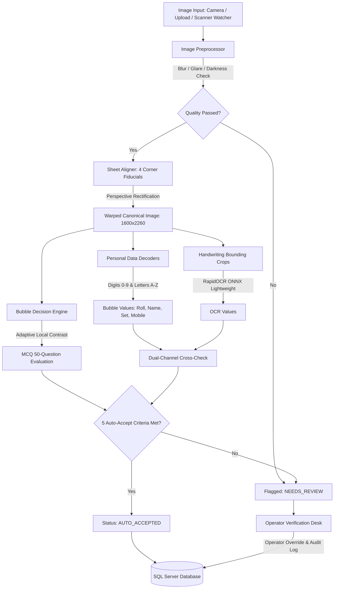

# OMR Optical Mark Recognition System - Operator & User Manual

Welcome to the **OMR Recognition System** user manual. This platform provides enterprise-grade, high-precision Optical Mark Recognition, dual-channel personal information cross-checking (handwriting OCR vs. bubble grids), automated grading against stored answer keys, and instant publication-ready PDF and Excel reporting.

---

## 1. System Architecture & Dual-Channel Pipeline

The recognition engine enforces a **0-defect auto-acceptance guarantee**: uncertain or questionable markings are **never silently saved**.

---

## 2. Default Roles and Credentials

Seed data provides two role tiers:

| Role | Username | Password | Privileges |
| :--- | :--- | :--- | :--- |
| **Admin** | `admin` | `Admin!2026Pass` | Full administrative control: user management, system audit logs, runtime threshold sliders, exam creation. |
| **Operator** | `operator` | `Operator!2026Pass` | Daily operations: camera scanning, file uploads, verification desk review, student lookups, report downloads. |

---

## 3. Creating Exams and Answer Keys

### 3.1 Creating an Exam
1. Navigate to the **Exams & Keys** tab.
2. Click **Create New Exam**.
3. Fill in:
   - **Exam Name**: e.g. `Graduation Standard Mock 2026`
   - **Exam Code**: e.g. `GSM-2026`
   - **Total Questions**: `50`
   - **Marks per Correct**: `1.0` (or custom e.g. `2.0`, `4.0`)
   - **Negative Marks**: `0.25` (or `0.0` for no deduction)
   - **Multi-Marked Rule**: Select whether multiple shaded bubbles count as `COUNT_AS_WRONG` or `COUNT_AS_NOT_ATTEMPTED`.
4. Click **Save Exam**.

### 3.2 Setting Answer Keys
The system supports multiple test versions (Sets **A**, **B**, **C**, **D**).
- **Interactive Matrix**: Select the Set tab and click on the option circles (`A`, `B`, `C`, `D`) for questions 1 through 50.
- **Bulk CSV Upload**: Upload an answer key spreadsheet in either format:
  - *Column Format*: `Question,SetA,SetB,SetC,SetD`
  - *Row Format*: `Set,Question,Answer`

---

## 4. Ingesting and Scanning OMR Sheets

The **Scan & Ingest** workspace provides three ingestion methods:

### Method A: Browser Camera Capture
- Live camera stream via `getUserMedia`.
- An on-screen alignment frame shows corner fiducial positioning guides.
- **Real-Time Quality Monitor**: Live indicators check lighting, darkness, blur, and glare.
- Click **Capture Sheet** to snap and ingest immediately.

### Method B: File & Batch Upload
- Drag-and-drop or file selector supporting **JPG, JPEG, PNG, TIFF, BMP, WEBP, and multi-page PDF**.
- Every page of a PDF is ingested as an individual sheet.
- **Batch Resilience**: One bad or unreadable sheet never halts the batch. The system processes all files and outputs a real-time progress card with status breakdown (`DONE`, `NEEDS_REVIEW`, `FAILED`).

### Method C: Scanner Hot-Folder Watcher
- Connect a physical sheet-fed document scanner configured to save scans to `./scans_input`.
- In the **Scanner Folder** tab, click **Process Scanner Folder**.
- All newly added files are ingested, evaluated, and automatically archived into `./scans_input/processed`.

---

## 5. The Verification Desk

Sheets with any uncertainty or discrepancy enter `NEEDS_REVIEW` and are routed to the **Verification Desk**.

### Auto-Acceptance Criteria
A sheet is **AUTO_ACCEPTED** only if all five rules pass:
1. All four corner fiducial markers found with clean perspective correction.
2. Zero uncertain bubbles across all 50 questions.
3. Roll number fully decoded without blank or multi-marked columns.
4. Candidate Name bubble-grid value matches handwritten box OCR with similarity $\ge 75\%$.
5. Roll number is not a duplicate for this exam.

### Verification Desk Controls
- **Side-by-Side View**: Zoom and pan the high-resolution scanned sheet alongside the diagnostic crop.
- **Dual-Channel Audit Box**: Displays bubble-extracted value, handwriting OCR crop, and an editable field for final operator decision.
- **Item Response Overrides**: Click any question bubble to adjust or confirm questionable answers.
- **Recheck Button**: Re-runs the recognition algorithm with a stricter threshold.
- **Save and Next**: Saves confirmed values to SQL Server, registers an entry in the immutable `AuditLog`, and advances to the next review sheet.

---

## 6. Results & Visual Scorecards

- Navigate to the **Results** tab to browse evaluated sheets across exams.
- Filter by Exam, Set, or Status (`AUTO_ACCEPTED`, `NEEDS_REVIEW`, `CONFIRMED`).
- Click **View** on any candidate to inspect their interactive **50-Question Response Matrix**:
  - **Green**: Correct answer
  - **Red**: Wrong answer
  - **Gray**: Unattempted / Blank
  - **Yellow/Amber**: Multi-marked question
- Click **PDF Card** to download the official student scorecard.

---

## 7. Candidate Master Search

- Navigate to the **Students** tab.
- Search candidates by **Roll Number**, **Name**, or **Mobile Phone**.
- Open any candidate's profile to view historical exam scores and inspect the original scan image.

---

## 8. Exporting Reports

Navigate to the **Reports** tab to generate publication-grade exports:
1. **ReportLab PDF Executive Summary**:
   - High-level KPI cards (Total Scans, Top Score, Average, Pass Rate).
   - Complete Merit Roster sorted by rank with verification stamps.
2. **openpyxl Excel Workbook (.xlsx)**:
   - **Sheet 1 (Merit Roster)**: Detailed candidate data, marks, percentages, and verification statuses with formatted headers and column widths.
   - **Sheet 2 (Executive Summary)**: Summary aggregates and acceptance statistics.

---

## 9. Admin Settings & Audit Trails

*(Accessible by users with the `Admin` role)*
- **User Management**: Add new operator accounts and toggle roles.
- **System Audit Logs**: Real-time audit log recording every operator change, timestamp, IP address, and old vs. new value diffs.
- **Runtime Threshold Sliders**:
  - *Bubble Fill Ratio Threshold*: default 45% (range: 30% - 70%)
  - *Bubble Uncertain Lower Bound*: default 30% (range: 15% - 40%)
  - *OCR Name Similarity Threshold*: default 75% (range: 50% - 95%)
